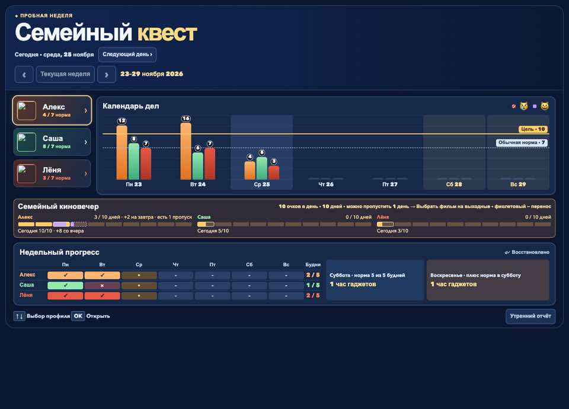

# Семейный квест

Шаблон семейного трекера с детским экраном Android и мобильной веб-панелью для родителей. Настройте семью и правила, запустите свой журнал, затем подключите подходящие устройства.

[Открыть демо](https://khunkomarov.github.io/family-quest-starter/?demo=1) · [Создать свою копию](https://github.com/new?template_name=family-quest-starter&template_owner=KhunKomarov) · [Скачать проверенную версию](https://github.com/KhunKomarov/family-quest-starter/releases/latest)



## Начать с нейросетью

Передайте нейросети ссылку на этот репозиторий или архив из Releases и скопируйте запрос:

> Прочитай README.md, AGENTS.md и docs/intake.md в этом проекте. Помоги установить семейный трекер у меня дома. Сначала уточни состав семьи, модели экранов, местное время, задания и накопительную цель. Покажи демо, затем проведи меня через сервер, родительскую панель и подключение детских экранов. Проверяй каждый шаг вместе со мной.

**Если вас пригласил автор, отдельный сервер арендовать не нужно.** У каждой семьи будет свой адрес, отдельный журнал и свои доступы на существующем сервере. Передайте нейросети [инструкцию подключения по приглашению](docs/hosted.md) и скажите: «Используем сервер автора; помоги подготовить нашу семью и получить её пакет подключения». Это вариант по приглашению, без открытой регистрации. [Владельцу общего сервера](docs/operator-hosting.md).

Агенту с доступом к терминалу можно поручить сборку и установку. В обычном чате следуйте его инструкциям на своём компьютере.

## Попробовать за минуту

Скачайте репозиторий, откройте терминал в его корне и запустите:

```sh
python3 -m http.server 8080 --bind 127.0.0.1 --directory web
```

Откройте [демо в браузере](http://127.0.0.1:8080/?demo=1). Выберите Алекса, Сашу или Лёню. Перейдите между вкладками мышью или стрелками и Enter. Демо использует вымышленные данные и работает без сервера журнала.

| Раздел | Что в нём | Пример |
| --- | --- | --- |
| До школы | Повторяется каждый день. Утренний минимум открывает зачёт следующих дел | Заправить кровать, позавтракать |
| После школы | Ежедневные общие и личные задания | Разложить одежду, убрать игрушки |
| Суперзадания | Дополнительные дела по правилам семьи | Прочитать и пересказать, придумать песню |
| Задание дня | Публикуется родителем на сегодня. У каждого своя отметка | Полить цветы |
| Накопительная цель | Прогресс за несколько дней, перенос излишка, один пропуск по выбору семьи | Семейный киновечер. Награда — выбрать фильм |

В демо Алекс набрал 12 очков в понедельник и перенёс 2 на вторник. Во вторник он набрал ещё 16. Из 18 очков 10 закрыли норму, 8 перешли на среду. В среду 4 очка дополнили перенос, и 2 уже в запасе на четверг. Фиолетовая часть — перенос, пунктир — запас на завтра.

## Настроить для своей семьи

1. Передайте репозиторий агенту и скажите: «Возьми этот трекер за основу. Начни с [инструкции для агента](AGENTS.md) и [списка вводных](docs/intake.md). Покажи мне план и настройки на примере моей семьи».
2. В [config/family.json](config/family.json) укажите имена трёх профилей, смещение времени и название, награду, порог и длину накопительной цели. Выполните `python3 scripts/configure.py`.
3. Дела можно добавлять из родительской панели. Чтобы заранее подготовить стартовый список, измените [sync/catalog.json](sync/catalog.json) по [правилам настройки](docs/customize.md).
4. По [инструкции запуска](docs/install.md) заведите общий журнал, откройте панель родителям и соберите Android-приложение для телевизора, планшета или совместимого автомобильного экрана.

Для работающего круглый день журнала используйте [ориентир по серверу и готовую настройку Ubuntu](docs/hosting.md). При адаптации интерфейса к другой модели начните с [памятки для пульта и сенсорных экранов](docs/screens.md).

В этой версии один экземпляр приложения обслуживает одну семью из трёх профилей. На общем VPS можно запустить несколько изолированных экземпляров по [инструкции владельца сервера](docs/operator-hosting.md). Для другого количества профилей потребуется доработка. Пример смещения времени фиксирован и не переключается на летнее время автоматически. Семейная награда выдаётся родителем. Экранное время и жетоны показывают пример вознаграждений, а системные лимиты родитель применяет отдельно.

Код и примеры распространяются под лицензией MIT. Сохраняйте уведомление об авторстве и текст лицензии при распространении своей версии. [Лицензия](LICENSE)
